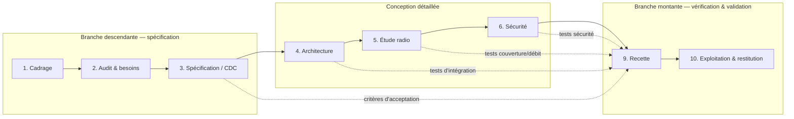

# Démarche méthodologique — Cycle en V et PMBOK

> **Objet** : rendre explicite la méthodologie du projet et son inscription dans les phases.
> **Principe** : le **cycle en V** décrit le cycle de vie produit (phases et validations) ; **PMBOK** décrit le pilotage projet (groupes de processus et domaines de connaissance). Les deux se superposent.

| | |
|---|---|
| **Référence** | METH-WIFI-2026-001 |
| **Version** | 1.0 |
| **Approche** | Prédictive (périmètre stable, 3 mois, livrables définis) |

---

## 1. Le cycle en V du projet

**Phases transverses (pilotage, hors branche V) :**
- **7. Chiffrage** — s'appuie sur l'architecture (4) et l'étude radio (5) ;
- **8. Planification** — s'appuie sur la recette (9) et les risques ;
- **Gestion de projet** — continue de J1 à J10.

## 2. Correspondance conception ↔ validation

Chaque production de la branche descendante est validée par une phase de la branche montante :

| Phase de conception | Validation symétrique | Critère |
|---|---|---|
| 2. Audit & besoins | 9. Recette (acceptation) | Besoins tracés dans la RTM, critères mesurables |
| 3. Spécification / CDC | 9. Recette (système) | Chaque exigence M couverte par un test |
| 4. Architecture | 9. Recette (intégration) | Revue J4 + tests d'intégration |
| 5. Étude radio | 9. Recette (couverture/débit) | ≥ -65 dBm, débit, itinérance |
| 6. Sécurité | 9. Recette (sécurité) | 802.1X, isolation invités, journalisation |

## 3. Rattachement aux processus PMBOK 6e

| Phase | Groupe de processus PMBOK | Processus mobilisés (6e éd.) | Domaine PMBOK 7 |
|---|---|---|---|
| 1. Cadrage | Démarrage | 4.1 Charte, 13.1 Parties prenantes | Stakeholders |
| 2. Audit & besoins | Planification + Exécution | 5.2 Collecter les exigences | Planning |
| 3. Spécification | Planification | 5.2, 5.3 Définir le périmètre | Planning |
| 4. Architecture | Planification + Exécution | 5.3, 8.1 Planifier la qualité | Delivery |
| 5. Étude radio | Exécution | Domaine *Delivery* | Delivery |
| 6. Sécurité | Exécution | Domaine *Delivery* | Delivery |
| 7. Chiffrage | Planification | 7.2 Estimer, 7.3 Budget, 12.1 Approvisionnements | Planning |
| 8. Planification | Planification | 6.5 Durées, 6.6 Calendrier, 11.1→11.5 Risques | Planning / Uncertainty |
| 9. Recette | Surveillance & contrôle | 8.3 Contrôler la qualité, 5.5 Valider le périmètre | Measurement |
| 10. Exploitation & restitution | Clôture | 4.7 Clore le projet / la phase | Measurement |
| Transverse | Surveillance & contrôle | 4.5 Contrôle intégré, 4.6 Surveiller, 7.4 Contrôler les coûts | Measurement |

## 4. Visibilité dans les artefacts existants

| Artefact | Ce qui y rend la démarche visible |
|---|---|
| `charte-projet.md` | § approche de livraison, méthodologie, jalons J1→J10 |
| `wbs.md` | Découpage **par phases du cycle en V** (lots 1→10), note d'intégrité |
| `plan-calendrier-gantt.md` | Activités ordonnées selon les phases, jalons de validation |
| `diagrammes-gantt-pert.md` | Chemin critique = chaîne conception→validation |
| `matrice-exigences.md` | Traçabilité exigence → livrable → **test de recette** (branche montante) |
| `registre-risques.md` | Risques par phase, revue à chaque fin de phase |

## 5. Règles de gestion du cycle en V

1. **Aucune phase aval ne démarre sans validation de la phase amont** (jalon) ;
2. **Toute exigence** doit être traçable à un test de la branche montante (RTM) ;
3. **Revue de phase** à chaque jalon : conformité des livrables + mise à jour des risques ;
4. **Contrôle intégré des changements** : toute modification de périmètre repasse par la phase concernée ;
5. **Clôture** : leçons apprises et archivage du dossier.

## 6. Ce que la démarche n'est pas

- Ce n'est **pas** une démarche agile : pas de sprints, périmètre figé, livrables contractuels ;
- Le cycle en V ne couvre **pas l'exécution physique** (pose, câblage) : le V s'arrête à la validation du dossier d'étude.
