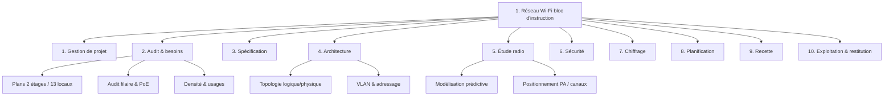

# WBS — Structure de découpage du travail

> **Processus PMBOK 6e — 5.3 Définir le périmètre / 5.4 Créer le WBS**
> Décomposition hiérarchique du périmètre. La somme des lots enfant = 100 % du périmètre du projet.
> Périmètre : bloc d'instruction (2 étages, 7 bureaux, 5 salles de classe, 1 salle de réunion) — durée 3 mois.

| | |
|---|---|
| **Référence** | WBS-WIFI-2026-001 |
| **Version** | 1.0 |
| **Durée** | 3 mois (13 semaines) |
| **Approche de découpage** | Par phases du cycle en V (livrables) |

---

## 1. Arborescence WBS (avec codes)

**1. Gestion de projet**
- 1.1 Cadrage et charte du projet
- 1.2 Registre des parties prenantes
- 1.3 Plan de management du projet
- 1.4 Suivi, contrôle et reporting
- 1.5 Clôture et leçons apprises

**2. Audit de l'existant et recueil des besoins**
- 2.1 Collecte des plans du bloc d'instruction (2 étages, 13 locaux)
- 2.2 Audit du réseau filaire et de l'alimentation PoE
- 2.3 Relevé des usages et de la densité (5 salles de classe, 7 bureaux, 1 salle de réunion)
- 2.4 Cartographie du bâti (murs épais, gaines, contraintes radio)
- 2.5 Fiches de besoins par zone et catégorie d'utilisateurs

**3. Spécification et cahier des charges**
- 3.1 Exigences de couverture
- 3.2 Exigences de capacité et de débit
- 3.3 Exigences de sécurité et de QoS
- 3.4 Rédaction du cahier des charges technique
- 3.5 Validation du cahier des charges

**4. Conception de l'architecture réseau**
- 4.1 Choix technologiques (Wi-Fi 6/6E, contrôleur)
- 4.2 Topologie logique et physique
- 4.3 Plan d'adressage IP
- 4.4 Segmentation VLAN (pédagogique, administratif, invités, IoT)
- 4.5 Intégration au réseau filaire et à l'accès Internet
- 4.6 Schémas et dossier d'architecture

**5. Étude radio et dimensionnement**
- 5.1 Modélisation prédictive (simulation)
- 5.2 Relevé de site (site survey) par étage
- 5.3 Positionnement des points d'accès
- 5.4 Plan de canaux et puissances d'émission
- 5.5 Cartes de couverture (cartes thermiques) et validation

**6. Conception sécurité et authentification**
- 6.1 Architecture d'authentification centralisée 802.1X (RADIUS)
- 6.2 Portail et accès invités
- 6.3 Filtrage, segmentation et journalisation
- 6.4 Politique de sécurité et validation RSSI

**7. Estimation budgétaire et approvisionnement**
- 7.1 Nomenclature des équipements (PA, switchs PoE, contrôleur)
- 7.2 Devis estimatif (CAPEX)
- 7.3 Coût d'exploitation (OPEX)
- 7.4 Comparaison des solutions et analyse coût/bénéfice
- 7.5 Plan d'approvisionnement

**8. Planification du déploiement**
- 8.1 WBS et dictionnaire WBS
- 8.2 Diagramme de Gantt et chemin critique
- 8.3 Phasage par étage (RDC puis 1er étage)
- 8.4 Plan des ressources
- 8.5 Registre et plan de gestion des risques

**9. Plan de tests et de recette**
- 9.1 Définition des critères de performance mesurables
- 9.2 Plan de tests (couverture, débit, itinérance, charge)
- 9.3 Zone pilote / simulation
- 9.4 Rapport de validation

**10. Exploitation, formation et restitution**
- 10.1 Guide d'exploitation et de supervision
- 10.2 Formation des administrateurs réseau
- 10.3 Dossier de restitution et archivage
- 10.4 Clôture et leçons apprises du dossier

---

## 2. Dictionnaire WBS (extrait — lots de niveau 2)

| Code | Lot de travail | Livrable | Responsable | Durée (sem.) |
|---|---|---|---|---|
| 1 | Gestion de projet | Plans PMBOK, rapports | Chef de projet | 1→13 (transverse) |
| 2 | Audit et besoins | Rapport d'audit, fiches de besoins | Ingénieur réseau / chef de projet | 1,5 |
| 3 | Spécification | Cahier des charges technique | Chef de projet + RSSI | 1 |
| 4 | Architecture | Dossier d'architecture, schémas | Architecte réseau | 2 |
| 5 | Étude radio | Cartes de couverture, plan de canaux | Ingénieur radio | 2 |
| 6 | Sécurité | Politique de sécurité | Expert sécurité / RSSI | 1,5 |
| 7 | Chiffrage | Budget, devis, plan d'appro | Acheteur + chef de projet | 1,5 |
| 8 | Planification | WBS, Gantt, registre risques | Chef de projet | 1,5 |
| 9 | Recette | Plan de tests, rapport pilote | Ingénieur QA réseau | 1,5 |
| 10 | Exploitation & restitution | Guide, formation, dossier final | Chef de projet | 1 |

## 3. Représentation arborescente (Mermaid)

## 4. Note d'intégrité

Le WBS couvre les 10 phases du cycle en V décrites dans la charte et l'intégralité des livrables du §5 de la charte. L'exécution physique (pose, câblage) est **hors WBS** (hors périmètre).
