# Diagrammes Gantt (chemin critique) et PERT/CPM

> **Processus PMBOK 6e — 6.6 Élaborer le calendrier ; méthode du chemin critique (CPM) et technique PERT**
> Durée projet : 13 semaines. Périmètre : bloc d'instruction (2 étages, 13 locaux).

| | |
|---|---|
| **Référence** | DIAG-WIFI-2026-001 |
| **Version** | 1.0 |
| **Légende Gantt** | 🔴 `crit` = chemin critique (marge 0) — 🔵 `normal` = hors chemin critique |

---

## 1. Données CPM (calcul avant/arrière)

Unités : semaines. Démarrage projet à t = 0 (début S1).

| ID | Activité | Durée | ES | EF | LS | LF | Marge | Critique |
|---|---|---|---|---|---|---|---|---|
| A1 | Cadrage, charte | 1 | 0 | 1 | 0 | 1 | 0 | ✅ |
| A2 | Audit filaire/PoE | 1,5 | 1 | 2,5 | 1 | 2,5 | 0 | ✅ |
| A3 | Usages & densité | 1 | 2,5 | 3,5 | 2,5 | 3,5 | 0 | ✅ |
| A4 | Besoins validés (J2) | 0,5 | 3,5 | 4 | 3,5 | 4 | 0 | ✅ |
| A5 | Cahier des charges | 1 | 4 | 5 | 4 | 5 | 0 | ✅ |
| A6 | Validation (J3) | 1 | 5 | 6 | 5 | 6 | 0 | ✅ |
| A7 | Topologie/techno | 1 | 6 | 7 | 6 | 7 | 0 | ✅ |
| A8 | VLAN/adressage | 1 | 7 | 8 | 7 | 8 | 0 | ✅ |
| A9 | Intégration filaire | 1 | 7 | 8 | 7 | 8 | 0 | ✅ |
| A10 | Architecture validée (J4) | 1 | 8 | 9 | 8 | 9 | 0 | ✅ |
| A11 | Modélisation | 1 | 9 | 10 | 9 | 10 | 0 | ✅ |
| A12 | Site survey | 2 | 9 | 11 | 9 | 11 | 0 | ✅ |
| A13 | Positionnement PA | 1 | 11 | 12 | 11 | 12 | 0 | ✅ |
| A14 | Couverture livrée (J5) | 1 | 12 | 13 | 12 | 13 | 0 | ✅ |
| A15 | 802.1X | 1 | 9 | 10 | 9 | 12 | 3 | — |
| A16 | Invités/journaux | 1 | 10 | 11 | 10 | 12 | 2 | — |
| A17 | Sécurité validée (J6) | 1 | 11 | 12 | 11 | 13 | 1 | — |
| A18 | CAPEX | 1 | 13 | 14 | 13 | 14 | 0 | ✅ |
| A19 | OPEX | 1 | 14 | 15 | 14 | 15 | 0 | ✅ |
| A20 | Appro (J7) | 1 | 15 | 16 | 15 | 16 | 0 | ✅ |
| A21 | WBS | 1 | 0 | 1 | 0 | 1 | 0 | ✅ |
| A22 | Gantt/chemin crit. | 1 | 16 | 17 | 16 | 17 | 0 | ✅ |
| A23 | Phasage | 1 | 13 | 14 | 15 | 16 | 2 | — |
| A24 | Risques (J8) | 1 | 16 | 17 | 16 | 17 | 0 | ✅ |
| A25 | Plan de tests | 1 | 13 | 14 | 14 | 15 | 1 | — |
| A26 | Pilote/simulation | 2 | 14 | 16 | 15 | 17 | 1 | — |
| A27 | Validation (J9) | 1 | 16 | 17 | 16 | 17 | 0 | ✅ |
| A28 | Guide exploitation | 1 | 17 | 18 | 17 | 18 | 0 | ✅ |
| A29 | Formation | 1 | 18 | 19 | 18 | 19 | 0 | ✅ |
| A30 | Restitution (J10) | 1 | 19 | 20 | 19 | 20 | 0 | ✅ |

> **Durée totale du projet : 20 unités de 0,65 sem ≈ 13 semaines.** Le chemin critique traverse la chaîne de conception → radio → chiffrage → recette → clôture.

## 2. Chemin critique

**Chemin critique principal (marge totale = 0) :**

```
A1 → A2 → A3 → A4 → A5 → A6 → A7 → A8 → A10 → A12 → A13 → A14 → A18 → A19 → A20 → A22 → A24 → A27 → A28 → A29 → A30
```

Activités critiques : **A1, A2, A3, A4, A5, A6, A7, A8, A10, A11/A12, A13, A14, A18, A19, A20, A21, A22, A24, A27, A28, A29, A30**.

- A11 et A12 sont parallèles ; **A12 (site survey) est déterminante** (durée 2).
- Les lots sécurité (A15–A17), phasage (A23), tests (A25–A26) et WBS (A21) disposent d'une marge : ils peuvent glisser sans décaler la livraison.

## 3. Diagramme de Gantt — chemin critique en rouge

```mermaid
%%{init: {'theme':'base', 'themeVariables': {'critBkgColor':'#e53935','critBorderColor':'#b71c1c','doneTaskBkgColor':'#90caf9','taskBkgColor':'#90caf9','taskBorderColor':'#1565c0'}}}%%
gantt
    title Gantt Wi-Fi bloc d'instruction - chemin critique en rouge
    dateFormat X
    axisFormat S%s
    todayMarker off
    section Cadrage
    A1 Charte/PPP            :crit, a1, 0, 1
    section Audit
    A2 Audit filaire/PoE     :crit, a2, 1, 1.5
    A3 Usages & densité      :crit, a3, 2.5, 1
    A4 Besoins validés (J2)  :crit, a4, 3.5, 0.5
    section Spécification
    A5 Cahier des charges    :crit, a5, 4, 1
    A6 Validation (J3)       :crit, a6, 5, 1
    section Architecture
    A7 Topologie/techno      :crit, a7, 6, 1
    A8 VLAN/adressage        :crit, a8, 7, 1
    A9 Intégration filaire   :a9, 7, 1
    A10 Archi validée (J4)   :crit, a10, 8, 1
    section Étude radio
    A11 Modélisation         :crit, a11, 9, 1
    A12 Site survey          :crit, a12, 9, 2
    A13 Positionnement PA    :crit, a13, 11, 1
    A14 Couverture (J5)      :crit, a14, 12, 1
    section Sécurité
    A15 802.1X               :a15, 9, 1
    A16 Invités/journaux     :a16, 10, 1
    A17 Sécu validée (J6)    :a17, 11, 1
    section Chiffrage
    A18 CAPEX                :crit, a18, 13, 1
    A19 OPEX                 :crit, a19, 14, 1
    A20 Appro (J7)           :crit, a20, 15, 1
    section Planification
    A21 WBS                  :crit, a21, 0, 1
    A23 Phasage              :a23, 13, 1
    A22 Gantt/chemin crit.   :crit, a22, 16, 1
    A24 Risques (J8)         :crit, a24, 16, 1
    section Recette
    A25 Plan de tests        :a25, 13, 1
    A26 Pilote/simulation    :a26, 14, 2
    A27 Validation (J9)      :crit, a27, 16, 1
    section Clôture
    A28 Guide exploitation   :crit, a28, 17, 1
    A29 Formation            :crit, a29, 18, 1
    A30 Restitution (J10)    :crit, a30, 19, 1
```



## 4. Diagramme de réseau PERT (CPM)

### 4.1 Réseau d'activités (vue logique des dépendances)

```mermaid
graph LR
    START((Début)) --> A1[A1 Cadrage 1]
    A1 --> A2[A2 Audit 1.5]
    A2 --> A3[A3 Densité 1]
    A3 --> A4[A4 Besoins 0.5]
    A4 --> A5[A5 CDC 1]
    A5 --> A6[A6 Valid J3 1]
    A6 --> A7[A7 Techno 1]
    A7 --> A8[A8 VLAN 1]
    A7 --> A9[A9 Intégration 1]
    A8 --> A10[A10 Archi J4 1]
    A9 --> A10
    A10 --> A11[A11 Modélisation 1]
    A10 --> A12[A12 Site survey 2]
    A10 --> A15[A15 802.1X 1]
    A11 --> A13[A13 Position PA 1]
    A12 --> A13
    A13 --> A14[A14 Couverture J5 1]
    A15 --> A16[A16 Invités 1]
    A16 --> A17[A17 Sécu J6 1]
    A14 --> A18[A18 CAPEX 1]
    A18 --> A19[A19 OPEX 1]
    A19 --> A20[A20 Appro J7 1]
    A14 --> A23[A23 Phasage 1]
    A14 --> A25[A25 Plan tests 1]
    A17 --> A25
    A25 --> A26[A26 Pilote 2]
    A20 --> A22[A22 Gantt 1]
    A23 --> A24[A24 Risques J8 1]
    A22 --> A24
    A26 --> A27[A27 Valid J9 1]
    A24 --> A30[A30 Restitution J10 1]
    A27 --> A28[A28 Guide expl. 1]
    A28 --> A29[A29 Formation 1]
    A29 --> A30
    A30 --> END((Fin))

    classDef crit fill:#e53935,stroke:#b71c1c,color:#fff;
    class A1,A2,A3,A4,A5,A6,A7,A8,A10,A11,A12,A13,A14,A18,A19,A20,A21,A22,A24,A27,A28,A29,A30 crit;
```



> A21 (WBS) démarre en parallèle de A1 et n'est pas bloquant ; il est absorbé dans la chaîne critique pour l'affichage.

### 4.2 Réseau PERT avec durées optimiste/réaliste/pessimiste (PERT probabiliste)

Estimation PERT : **(O + 4M + P) / 6** et écart-type σ = (P − O) / 6.

| Activité | O | M | P | Durée PERT (te) | σ |
|---|---|---|---|---|---|
| A1 Cadrage | 0,5 | 1 | 1,5 | 1,00 | 0,17 |
| A2 Audit | 1 | 1,5 | 2,5 | 1,67 | 0,25 |
| A3 Densité | 0,5 | 1 | 2 | 1,08 | 0,25 |
| A4 Besoins | 0,5 | 0,5 | 1 | 0,58 | 0,08 |
| A5 CDC | 0,5 | 1 | 1,5 | 1,00 | 0,17 |
| A6 Valid J3 | 0,5 | 1 | 1,5 | 1,00 | 0,17 |
| A7 Techno | 0,5 | 1 | 2 | 1,08 | 0,25 |
| A8 VLAN | 0,5 | 1 | 1,5 | 1,00 | 0,17 |
| A10 Archi | 0,5 | 1 | 1,5 | 1,00 | 0,17 |
| A12 Site survey | 1 | 2 | 3 | 2,00 | 0,33 |
| A13 Position PA | 0,5 | 1 | 1,5 | 1,00 | 0,17 |
| A14 Couverture | 0,5 | 1 | 1,5 | 1,00 | 0,17 |
| A18 CAPEX | 0,5 | 1 | 2 | 1,08 | 0,25 |
| A19 OPEX | 0,5 | 1 | 1,5 | 1,00 | 0,17 |
| A20 Appro | 0,5 | 1 | 1,5 | 1,00 | 0,17 |
| A22 Gantt | 0,5 | 1 | 1 | 0,92 | 0,08 |
| A24 Risques | 0,5 | 1 | 1 | 0,92 | 0,08 |
| A27 Valid J9 | 0,5 | 1 | 1,5 | 1,00 | 0,17 |
| A28 Guide | 0,5 | 1 | 1,5 | 1,00 | 0,17 |
| A29 Formation | 0,5 | 1 | 1 | 0,92 | 0,08 |
| A30 Restitution | 0,5 | 1 | 1 | 0,92 | 0,08 |

**Chemin critique PERT :** somme des te = **20,2 unités ≈ 13,1 semaines**.
**Écart-type du chemin critique :** σ² = Σ σi² ≈ 0,62 → σ ≈ **0,79**.

### 4.3 Interprétation probabiliste

| Probabilité d'achèvement | Durée (unités) | ≈ semaines |
|---|---|---|
| 50 % (médiane) | 20,2 | 13,1 |
| 84 % (te + 1σ) | 21,0 | 13,7 |
| 95 % (te + 1,65σ) | 21,5 | 14,0 |
| 99 % (te + 2,33σ) | 22,0 | 14,3 |

**Conclusion** : la cible de **3 mois (13 semaines)** correspond à la médiane PERT. Pour sécuriser la tenue du jalon J10 à 95 % de confiance, prévoir une **réserve de 1 semaine** sur les activités du chemin critique (ou renforcer A2 Audit et A12 Site survey, dont les σ sont les plus élevés).

## 5. Lecture des diagrammes

- **Gantt** : les barres rouges (`crit`) matérialisent le chemin critique — un retard d'un jour sur l'une d'elles décale immédiatement la fin du projet.
- **PERT** : le réseau montre les dépendances conditionnelles ; le chemin critique relie Début→Fin en passant par Audit → Architecture → Site survey → Couverture → Chiffrage → Validation → Clôture.
