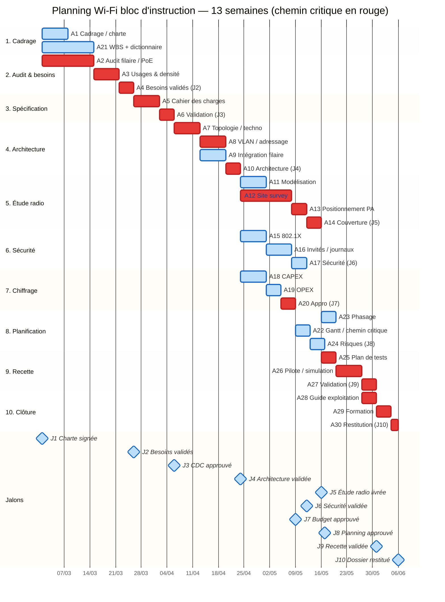
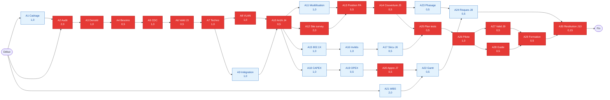

# Diagrammes Gantt et PERT/CPM — chemin critique

> **Processus PMBOK 6e — 6.5 Estimer les durées, 6.6 Élaborer le calendrier ; CPM et PERT**
> Périmètre : bloc d'instruction (2 étages, 13 locaux). Durée : **13 semaines**.
> Date de référence : **lundi 01/03/2027** (paramétrable — décale tout le planning de façon homogène).

| | |
|---|---|
| **Référence** | DIAG-WIFI-2026-001 |
| **Version** | 1.1 |
| **Légende** | 🔴 rouge = chemin critique (marge = 0) · 🔵 bleu = hors chemin critique · ◆ = jalon |

---

## 1. Données CPM (calcul avant / arrière)

Unités : semaines depuis le démarrage (t = 0). ES/EF = début/fin au plus tôt ; LS/LF = au plus tard.

| ID | Activité | Durée | ES | EF | LS | LF | Marge | Critique |
|---|---|---|---|---|---|---|---|---|
| A1 | Cadrage, charte | 1,0 | 0 | 1 | 1 | 2 | 1,0 | — |
| A2 | Audit filaire / PoE | 2,0 | 0 | 2 | 0 | 2 | **0** | 🔴 |
| A3 | Usages & densité | 1,0 | 2 | 3 | 2 | 3 | **0** | 🔴 |
| A4 | Besoins validés — J2 | 0,5 | 3 | 3,5 | 3 | 3,5 | **0** | 🔴 |
| A5 | Cahier des charges | 1,0 | 3,5 | 4,5 | 3,5 | 4,5 | **0** | 🔴 |
| A6 | Validation — J3 | 0,5 | 4,5 | 5 | 4,5 | 5 | **0** | 🔴 |
| A7 | Topologie / techno | 1,0 | 5 | 6 | 5 | 6 | **0** | 🔴 |
| A8 | VLAN / adressage | 1,0 | 6 | 7 | 6 | 7 | **0** | 🔴 |
| A9 | Intégration filaire | 1,0 | 6 | 7 | 6 | 7 | 0 | 🔵 (parallèle) |
| A10 | Architecture — J4 | 0,5 | 7 | 7,5 | 7 | 7,5 | **0** | 🔴 |
| A11 | Modélisation prédictive | 1,0 | 7,5 | 8,5 | 8,5 | 9,5 | 1,0 | — |
| A12 | Site survey | 2,0 | 7,5 | 9,5 | 7,5 | 9,5 | **0** | 🔴 |
| A13 | Positionnement PA | 0,5 | 9,5 | 10 | 9,5 | 10 | **0** | 🔴 |
| A14 | Couverture — J5 | 0,5 | 10 | 10,5 | 10 | 10,5 | **0** | 🔴 |
| A15 | 802.1X | 1,0 | 7,5 | 8,5 | 7,5 | 8,5 | 0 | 🔵 |
| A16 | Invités / journalisation | 1,0 | 8,5 | 9,5 | 8,5 | 9,5 | 0 | 🔵 |
| A17 | Sécurité — J6 | 0,5 | 9,5 | 10 | 9,5 | 10 | 0,5 | — |
| A18 | CAPEX (avant-projet) | 1,0 | 9 | 10 | 9 | 10 | 0 | 🔵 |
| A19 | OPEX | 0,5 | 10 | 10,5 | 10 | 10,5 | 0 | 🔵 |
| A20 | Appro — J7 | 0,5 | 10,5 | 11 | 10,5 | 11 | **0** | 🔴 |
| A21 | WBS + dictionnaire | 2,0 | 0 | 2 | 11,15 | 13,15 | 11,15 | — |
| A22 | Gantt / chemin critique | 0,5 | 11 | 11,5 | 11 | 11,5 | 0,5 | — |
| A23 | Phasage + ressources | 0,5 | 10,5 | 11 | 11 | 11,5 | 0,5 | — |
| A24 | Risques — J8 | 0,5 | 11,5 | 12 | 12,5 | 13 | 0,5 | — |
| A25 | Plan de tests | 0,5 | 10,5 | 11 | 10,5 | 11 | **0** | 🔴 |
| A26 | Pilote / simulation | 1,0 | 11 | 12 | 11 | 12 | **0** | 🔴 |
| A27 | Validation — J9 | 0,5 | 12 | 12,5 | 12 | 12,5 | **0** | 🔴 |
| A28 | Guide exploitation | 0,5 | 12 | 12,5 | 12 | 12,5 | **0** | 🔴 |
| A29 | Formation | 0,5 | 12,5 | 13 | 12,5 | 13 | **0** | 🔴 |
| A30 | Restitution — J10 | 0,15 | 13 | 13,15 | 13 | 13,15 | **0** | 🔴 |

**Durée totale = 13,15 semaines ≈ 13 semaines (3 mois).**

## 2. Chemin critique

```
A2 → A3 → A4 → A5 → A6 → A7 → A8 → A10 → A12 → A13 → A14 → A25 → A26 → A27 → A28 → A29 → A30
```

- **A2** (audit) est critique : A1 (cadrage) a 1 semaine de marge et peut se faire en parallèle.
- **A8 / A9** sont parallèles ; A8 est retenu pour le tracé, A9 a la même marge nulle.
- **A12** (site survey, 2 semaines) est le principal levier : toute réduction du site survey raccourcit le projet.
- Les lots sécurité (A15–A17), chiffrage (A18–A20), planification (A22–A24) et WBS (A21) dispose de marge : ils peuvent glisser sans impacter J10.
- **Marge totale du projet = 0** : la livraison à 13 semaines dépend intégralement de la chaîne ci-dessus.

## 3. Diagramme de Gantt — chemin critique en rouge



## 4. Réseau PERT — activité sur nœud

### 4.1 Réseau complet par phase



### 4.2 Chemin critique isolé

```mermaid
flowchart LR
    classDef crit fill:#e53935,stroke:#b71c1c,color:#fff,stroke-width:2px
    S([Début]) --> A2[A2<br/>2,0] --> A3[A3<br/>1,0] --> A4[A4<br/>0,5] --> A5[A5<br/>1,0] --> A6[A6<br/>0,5] --> A7[A7<br/>1,0] --> A8[A8<br/>1,0] --> A10[A10<br/>0,5] --> A12[A12<br/>2,0] --> A13[A13<br/>0,5] --> A14[A14<br/>0,5] --> A25[A25<br/>0,5] --> A26[A26<br/>1,0] --> A27[A27<br/>0,5] --> A28[A28<br/>0,5] --> A29[A29<br/>0,5] --> A30[A30<br/>0,15] --> E([Fin])
    class A2,A3,A4,A5,A6,A7,A8,A10,A12,A13,A14,A25,A26,A27,A28,A29,A30 crit
```



> Lecture : la somme des durées du chemin critique = **13,15 semaines**. Toute activité rouge sans marge décale J10 au prorata de son retard.

## 5. Estimation PERT probabiliste

Formules : **te = (O + 4M + P) / 6** et **σ = (P − O) / 6**.

| Activité (chemin critique) | O | M | P | te | σ |
|---|---|---|---|---|---|
| A2 Audit | 1,5 | 2,0 | 2,5 | 2,00 | 0,17 |
| A3 Densité | 0,5 | 1,0 | 1,5 | 1,00 | 0,17 |
| A4 Besoins | 0,25 | 0,5 | 0,75 | 0,50 | 0,08 |
| A5 CDC | 0,5 | 1,0 | 1,5 | 1,00 | 0,17 |
| A6 Validation | 0,25 | 0,5 | 0,75 | 0,50 | 0,08 |
| A7 Techno | 0,5 | 1,0 | 1,5 | 1,00 | 0,17 |
| A8 VLAN | 0,5 | 1,0 | 1,5 | 1,00 | 0,17 |
| A10 Archi | 0,25 | 0,5 | 0,75 | 0,50 | 0,08 |
| A12 Site survey | 1,5 | 2,0 | 2,5 | 2,00 | 0,17 |
| A13 Position PA | 0,25 | 0,5 | 0,75 | 0,50 | 0,08 |
| A14 Couverture | 0,25 | 0,5 | 0,75 | 0,50 | 0,08 |
| A25 Plan tests | 0,25 | 0,5 | 0,75 | 0,50 | 0,08 |
| A26 Pilote | 0,75 | 1,0 | 1,25 | 1,00 | 0,08 |
| A27 Valid J9 | 0,25 | 0,5 | 0,75 | 0,50 | 0,08 |
| A28 Guide | 0,25 | 0,5 | 0,75 | 0,50 | 0,08 |
| A29 Formation | 0,25 | 0,5 | 0,75 | 0,50 | 0,08 |
| A30 Restitution | 0,10 | 0,15 | 0,25 | 0,16 | 0,03 |
| **Total** | | | | **13,16** | **σ ≈ 0,49** |

### Probabilités d'achèvement

| Confiance | Durée (sem.) | Date indicative |
|---|---|---|
| 50 % (médiane) | 13,2 | 31/05/2027 |
| 84 % (te + 1σ) | 13,7 | 05/06/2027 |
| 95 % (te + 1,65σ) | 14,0 | 08/06/2027 |
| 99 % (te + 2,33σ) | 14,3 | 11/06/2027 |

**Conclusion** : la cible de 3 mois correspond à la médiane. Pour sécuriser J10 à 95 %, prévoir une **réserve de 1 semaine** ou réduire A12 (site survey) et fiabiliser A2 (audit), qui concentrent les variances les plus fortes.

## 6. Ce qui a été amélioré

| Avant | Après |
|---|---|
| Axe en « secondes » (dateFormat X mal utilisé) | Dates réelles (`YYYY-MM-DD`) et axe en **jj/mm** |
| 20 unités abstraites | **13 semaines** cohérentes avec la charte |
| Aucune dépendance | Liaisons `after` et vraies durées en jours |
| Pas de jalons sur le Gantt | **10 jalons J1→J10** (◆) positionnés |
| Chemin critique non distingué | Barres rouges + légende + classe `crit` |
| PERT « plat » et illisible | Réseau par phase + **chemin critique isolé** + nœuds colorés |
| PERT incohérent (20,2 u.) | PERT recalé à **13,16 sem.** et σ = 0,49 |
