# Plan de gestion du calendrier et du déploiement

> **Processus PMBOK 6e — 6.5 Estimer les durées, 6.6 Élaborer le calendrier**
> Durée projet : 3 mois (13 semaines). Périmètre : bloc d'instruction (2 étages, 13 locaux).

| | |
|---|---|
| **Référence** | CAL-WIFI-2026-001 |
| **Version** | 1.0 |
| **Durée totale** | 13 semaines (3 mois) |
| **Méthode** | Cycle en V — chemin critique (CPM) |

---

## 1. Liste des activités, durées et dépendances

| ID | Activité | Durée | Débute | Fin | Prédécesseur | Ressource |
|---|---|---|---|---|---|---|
| A1 | Cadrage, charte, parties prenantes | 1 sem | S1 | S1 | — | Chef de projet |
| A2 | Collecte plans + audit filaire/PoE | 1,5 sem | S1 | S2 | — | Ingénieur réseau |
| A3 | Relevé usages et densité (13 locaux) | 1 sem | S2 | S2 | A2 | Chef de projet |
| A4 | Fiches de besoins validées (J2) | 0,5 sem | S3 | S3 | A2, A3 | Chef de projet |
| A5 | Rédaction cahier des charges | 1 sem | S3 | S4 | A4 | CP + RSSI |
| A6 | Validation cahier des charges (J3) | 0,5 sem | S4 | S4 | A5 | DSI |
| A7 | Choix technologiques + topologie | 1 sem | S5 | S5 | A6 | Architecte réseau |
| A8 | Plan d'adressage + segmentation VLAN | 0,5 sem | S5 | S6 | A7 | Architecte réseau |
| A9 | Intégration filaire + Internet | 0,5 sem | S6 | S6 | A7 | Architecte réseau |
| A10 | Dossier d'architecture validé (J4) | 0,5 sem | S6 | S6 | A8, A9 | DSI + RSSI |
| A11 | Modélisation prédictive (simulation) | 1 sem | S7 | S7 | A10 | Ingénieur radio |
| A12 | Site survey par étage | 1 sem | S7 | S8 | A10 | Ingénieur radio |
| A13 | Positionnement PA + plan de canaux | 0,5 sem | S8 | S8 | A11, A12 | Ingénieur radio |
| A14 | Cartes de couverture livrées (J5) | 0,5 sem | S8 | S8 | A13 | Ingénieur radio |
| A15 | Architecture d'authentification 802.1X | 0,5 sem | S9 | S9 | A10 | Expert sécurité |
| A16 | Portail invités + filtrage/journalisation | 0,5 sem | S9 | S9 | A15 | Expert sécurité |
| A17 | Politique de sécurité validée (J6) | 0,5 sem | S9 | S9 | A16 | RSSI |
| A18 | Nomenclature + devis estimatif (CAPEX) | 1 sem | S9 | S10 | A14 | Acheteur |
| A19 | Coût d'exploitation (OPEX) | 0,5 sem | S10 | S10 | A18 | Acheteur + compta |
| A20 | Comparaison solutions + plan d'appro (J7) | 0,5 sem | S10 | S10 | A19 | CP + compta |
| A21 | WBS + dictionnaire | 0,5 sem | S1 | S1 | — | Chef de projet |
| A22 | Gantt + chemin critique | 0,5 sem | S10 | S10 | A20 | Chef de projet |
| A23 | Phasage par étage + ressources | 0,5 sem | S10 | S10 | A14 | Chef de projet |
| A24 | Registre et plan des risques (J8) | 0,5 sem | S10 | S10 | A22, A23 | Chef de projet |
| A25 | Critères + plan de tests | 0,5 sem | S11 | S11 | A14, A17 | Ingénieur QA |
| A26 | Pilote / simulation | 1 sem | S11 | S12 | A25 | Ingénieur QA |
| A27 | Rapport de validation (J9) | 0,5 sem | S12 | S12 | A26 | Ingénieur QA |
| A28 | Guide d'exploitation + supervision | 0,5 sem | S12 | S12 | A27 | Ingénieur réseau |
| A29 | Formation des administrateurs | 0,5 sem | S13 | S13 | A28 | Ingénieur réseau |
| A30 | Restitution + clôture (J10) | 0,5 sem | S13 | S13 | A29, A24 | Chef de projet |

## 2. Chemin critique

Séquence déterminante (durée cumulée = 13 semaines) :

**A1 → A2 → A3 → A4 → A5 → A6 → A7 → A8/A9 → A10 → A11/A12 → A13 → A14 → A25 → A26 → A27 → A28 → A29 → A30**

- **Marge totale = 0** sur ces activités : tout retard décale la livraison.
- Activités hors chemin critique avec marge : A21 (WBS, fait tôt), A15–A17 (sécurité, parallélisable), A18–A20 (chiffrage, parallèle à la sécurité/radio), A22–A24 (planification).
- **Point de regroupement critique** : A14 (cartes de couverture) alimente à la fois la recette (A25) et le phasage (A23).

## 3. Phasage du déploiement par étage (planifié, hors exécution)

L'exécution physique est hors périmètre, mais le phasage est planifié pour informer le commanditaire :

| Phase | Périmètre | Fenêtre recommandée | Contrainte |
|---|---|---|---|
| Phase 1 | RDC (3 salles + 4 bureaux) | Hors périodes de cours / vacances | Non-perturbation (REQ-14) |
| Phase 2 | 1er étage (2 salles + 3 bureaux + réunion) | Après recette phase 1 | Retour d'expérience phase 1 |
| Zone pilote | 1 salle de classe RDC | Avant phase 1 | Validation des critères (A26) |

## 4. Diagramme de Gantt (Mermaid)

```mermaid
gantt
    title Déploiement Wi-Fi bloc d'instruction — 13 semaines
    dateFormat X
    axisFormat S%s
    section Cadrage
    A1 Charte/PPP            :a1, 0, 1
    section Audit
    A2 Audit filaire/PoE     :a2, 0, 2
    A3 Usages & densité      :a3, 1, 1
    A4 Besoins validés (J2)  :a4, 2, 1
    section Spécification
    A5 Cahier des charges    :a5, 2, 1
    A6 Validation (J3)       :a6, 3, 1
    section Architecture
    A7 Topologie/techno      :a7, 4, 1
    A8 VLAN/adressage        :a8, 4, 1
    A9 Intégration filaire   :a9, 5, 1
    A10 Archi validée (J4)   :a10, 5, 1
    section Étude radio
    A11 Modélisation         :a11, 6, 1
    A12 Site survey          :a12, 6, 2
    A13 Positionnement PA    :a13, 7, 1
    A14 Couverture (J5)      :a14, 7, 1
    section Sécurité
    A15 802.1X               :a15, 8, 1
    A16 Invités/journaux     :a16, 8, 1
    A17 Sécu validée (J6)    :a17, 8, 1
    section Chiffrage
    A18 CAPEX                :a18, 8, 1
    A19 OPEX                 :a19, 9, 1
    A20 Appro (J7)           :a20, 9, 1
    section Planification
    A21 WBS                  :a21, 0, 1
    A22 Gantt/chemin crit.   :a22, 9, 1
    A23 Phasage              :a23, 9, 1
    A24 Risques (J8)         :a24, 9, 1
    section Recette
    A25 Plan de tests        :a25, 10, 1
    A26 Pilote/simulation    :a26, 10, 2
    A27 Validation (J9)      :a27, 11, 1
    section Clôture
    A28 Guide exploitation   :a28, 11, 1
    A29 Formation            :a29, 12, 1
    A30 Restitution (J10)    :a30, 12, 1
```

## 5. Jalons

| Jalon | Semaine | Livrable |
|---|---|---|
| J1 | S1 | Charte signée |
| J2 | S3 | Audit et besoins validés |
| J3 | S4 | Cahier des charges approuvé |
| J4 | S6 | Architecture validée |
| J5 | S8 | Étude radio livrée |
| J6 | S9 | Politique de sécurité validée |
| J7 | S10 | Budget et appro validés |
| J8 | S10 | WBS, Gantt, risques approuvés |
| J9 | S12 | Recette validée |
| J10 | S13 | Dossier restitué, projet clos |

## 6. Nivellement des ressources

- Ingénieur radio : pic en S6–S8 (modélisation + site survey) → lisser en démarrant A11 dès S7.
- Expert sécurité : charge en S9 → peut anticiper A15 dès validation de l'architecture (S6) si disponible.
- Ressource critique : **Ingénieur radio** (chemin critique S7–S8) — ne pas surcharger.
