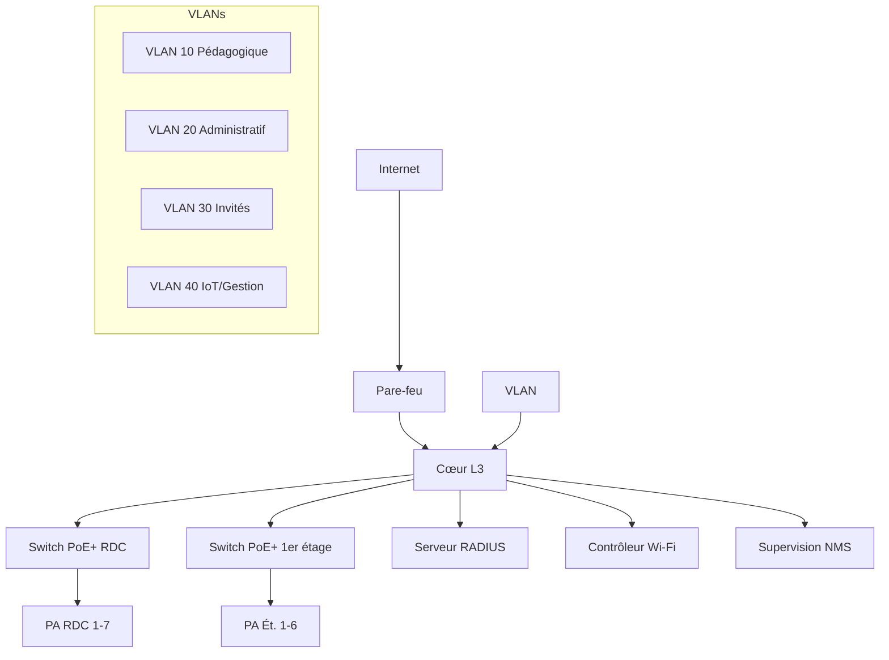

# Dossier d'architecture réseau

> **Processus PMBOK 6e — 5.3 Conception (domaine PMBOK 7 *Delivery*) ; sortie de la phase 4 du cycle en V**
> Périmètre : bloc d'instruction (2 étages, 7 bureaux, 5 salles de classe, 1 salle de réunion).

| | |
|---|---|
| **Référence** | ARCH-WIFI-2026-001 |
| **Version** | 1.0 |
| **Traçabilité** | Livrable WBS 4 ; exigences REQ-04, REQ-07, REQ-11, REQ-18 |

---

## 1. Choix technologiques

| Composant | Choix retenu | Justification | Traçabilité |
|---|---|---|---|
| Génération Wi-Fi | **Wi-Fi 6 (802.11ax)**, prêt Wi-Fi 6E (6 GHz) | Densité, efficacité OFDMA/MU-MIMO, évolutivité (REQ-18) | REQ-01, REQ-02 |
| Bande | 2,4 GHz + 5 GHz (6 GHz si 6E) | 2,4 pour couverture/IoT, 5 pour débit/densité | REQ-02, REQ-08 |
| Gestion | **Contrôleur** (on-premise) ou **gestion cloud** — recommandation : contrôleur local pour les 13 locaux | Maîtrise totale, pas de dépendance WAN, cohérent budget | REQ-04 |
| Alimentation | **PoE+ (802.3at)** 30 W/port | Alimente les PA sans alimentation locale | REQ-11 |
| Authentification | **802.1X / RADIUS** | Sécurité centralisée | REQ-05 |
| Agrégation | Switchs L2/L3 PoE+ | Distribution par étage | REQ-04 |

**Décision recommandée** : Wi-Fi 6/6E + contrôleur local + PoE+, solution évolutive et compatible avec l'infrastructure filaire existante (à confirmer après audit A2).

## 2. Topologie

### 2.1 Topologie logique

```
                 [Internet]
                     |
                 [Routeur / Pare-feu]
                     |
             [Cœur de réseau L3]
              /              \
    [Switch RDC PoE+]   [Switch 1er étage PoE+]
        |    |    |         |    |    |
       PA   PA   PA        PA   PA   PA   ... (points d'accès)
                     |
              [Serveur RADIUS]     [Contrôleur Wi-Fi]
                     |
              [Supervision NMS]
```

### 2.2 Topologie physique (par étage)

- **RDC** : 3 salles de classe + 4 bureaux = 7 locaux → ~7 PA + 1 switch PoE+
- **1er étage** : 2 salles de classe + 3 bureaux + salle de réunion = 6 locaux → ~6 PA + 1 switch PoE+
- Liaison montante RDC ↔ 1er étage : fibre optique ou cuivre Cat6a (selon existant)
- Armoire de distribution (IDF) par étage, armoire principale (MDF) au RDC

### 2.3 Schéma logique (Mermaid)



## 3. Plan d'adressage IP

Réseau : **10.20.0.0/16** (exemple — à ajuster au plan d'adressage de l'établissement).

| VLAN | ID | Nom | Sous-réseau | Passerelle | DHCP | Usage |
|---|---|---|---|---|---|---|
| Pédagogique | 10 | VLAN-PEDA | 10.20.10.0/24 | 10.20.10.1 | Externe | Étudiants / salles de classe |
| Administratif | 20 | VLAN-ADMIN | 10.20.20.0/24 | 10.20.20.1 | Externe | Bureaux / personnel |
| Invités | 30 | VLAN-GUEST | 10.20.30.0/24 | 10.20.30.1 | Local (isolé) | Accès invités |
| IoT / Gestion | 40 | VLAN-IOT | 10.20.40.0/24 | 10.20.40.1 | Statique | PA, contrôleur, caméras |
| Label | 99 | VLAN-MGMT | 10.20.99.0/24 | 10.20.99.1 | Statique | Administration équipements |

## 4. Plan de segmentation et règles de flux

| Source → Destination | Pédagogique | Administratif | Invités | IoT | Internet |
|---|---|---|---|---|---|
| Pédagogique | ✔ | ✖ | ✖ | ✖ | ✔ (filtré) |
| Administratif | ✖ | ✔ | ✖ | ✖ | ✔ |
| Invités | ✖ | ✖ | ✖ | ✖ | ✔ (débit limité) |
| IoT | ✖ | ✖ | ✖ | ✔ | ✖ (géré) |

- **Isolation inter-VLAN** par règles ACL sur le cœur L3 ;
- Invités : accès Internet uniquement, débit limité, isolation client (REQ-06) ;
- IoT/gestion : accès restreint aux flux d'administration.

## 5. Intégration au réseau filaire et à l'accès Internet

- Interconnexion des switchs PoE+ au cœur L3 (trunk 802.1Q) ;
- QoS : marquage DSCP pour visioconférence (REQ-09) ;
- Accès Internet : dimensionnement du débit sortant + éventuelle redondance ;
- Serveur RADIUS raccordé au cœur pour l'authentification 802.1X (REQ-05).

## 6. Bilan d'alimentation PoE

| Étage | Nb PA | Conso/PA | Total PoE | Switch | Marge |
|---|---|---|---|---|---|
| RDC | 7 | ~15 W | ~105 W | PoE+ 48 ports (≈370 W) | ✔ |
| 1er étage | 6 | ~15 W | ~90 W | PoE+ 48 ports (≈370 W) | ✔ |
| **Total** | 13 | | ~195 W | | Large marge pour extension |

## 7. Critères de validation (revue J4)

- Schémas logique et physique validés par la DSI ;
- Plan d'adressage et segmentation validés par le RSSI ;
- Bilan PoE et compatibilité filaire confirmés après audit A2.
